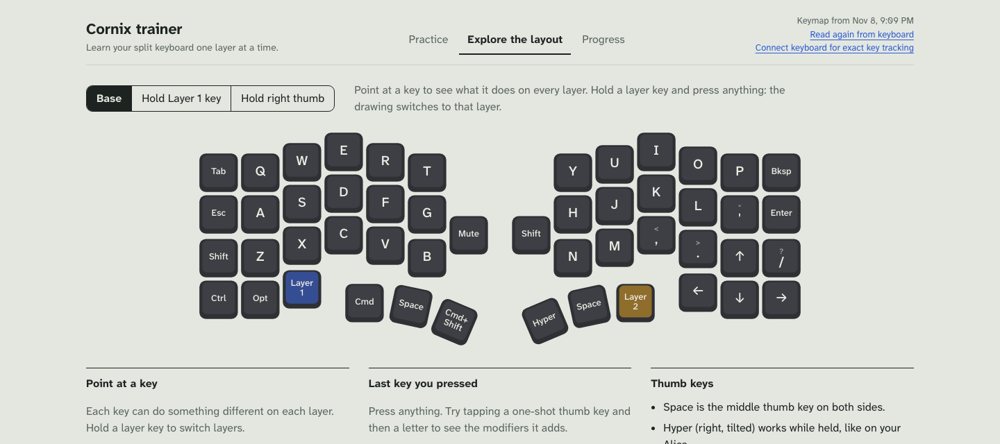
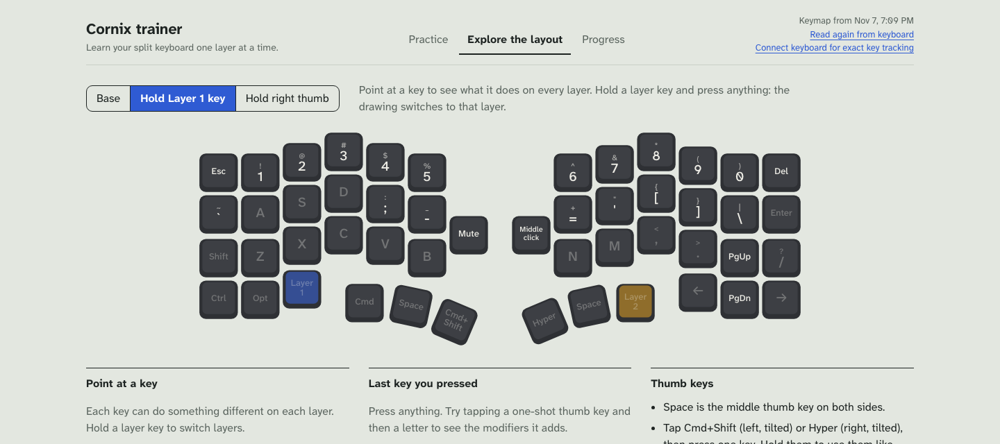
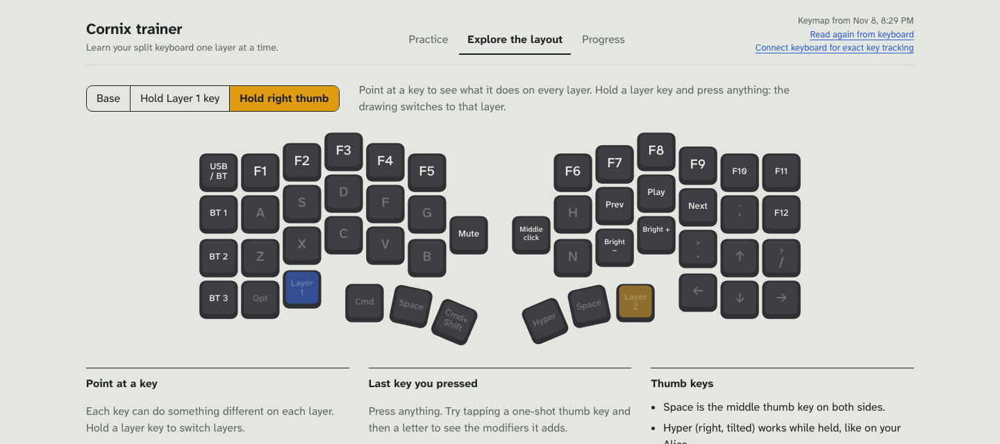
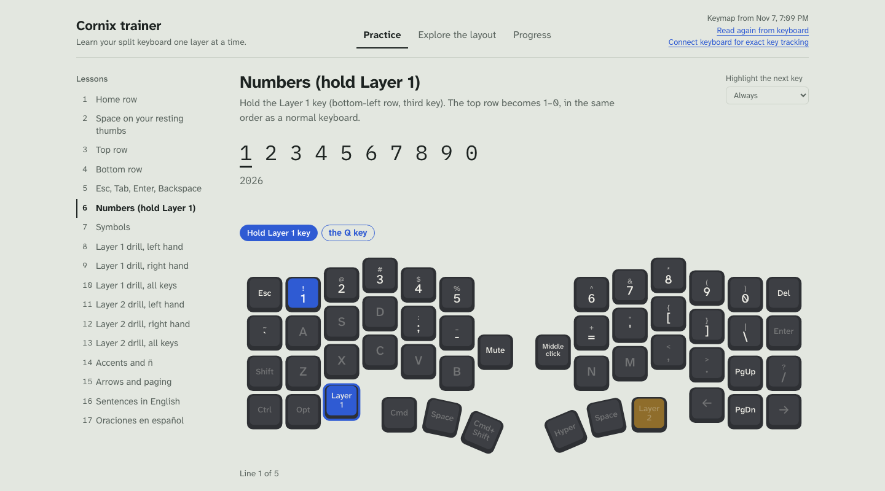
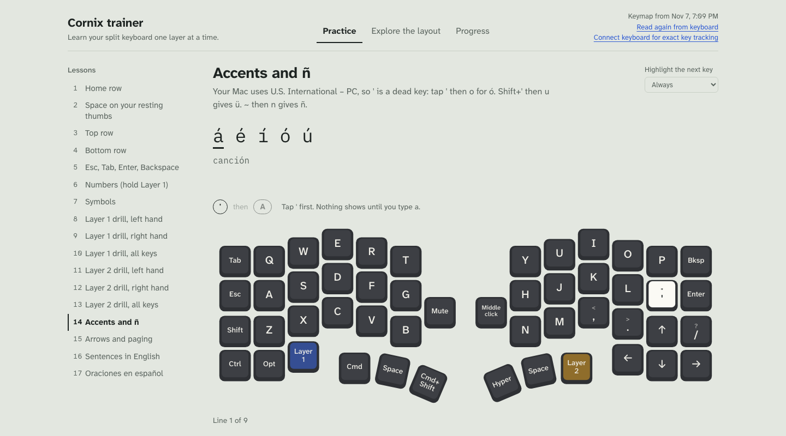
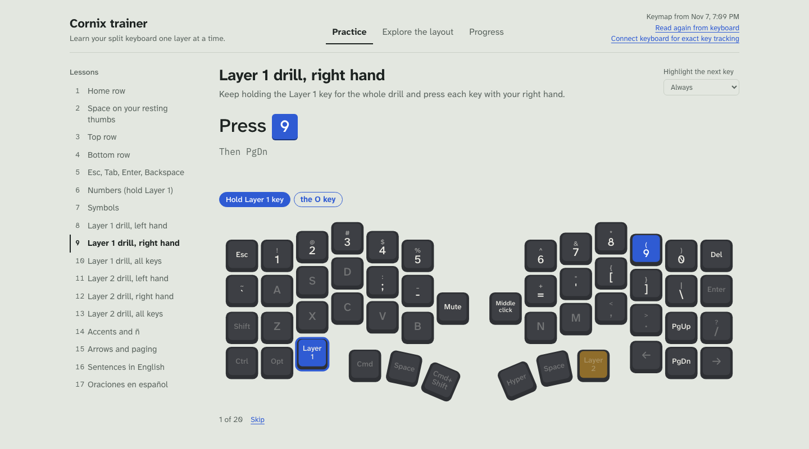

# Cornix trainer

A personal practice app for **my own Cornix layout**. It's for learning and drilling the keymap I set up on my Cornix split keyboard (Jezail Funder, Vial firmware). It isn't a general keyboard trainer.

The lessons, drills and keyboard drawing are all built around this one keymap: Esc where Caps Lock was, Cmd on the left thumb, numbers and symbols on Layer 1, F-keys on Layer 2, and Spanish accents with the U.S. International – PC input source on macOS. On another keyboard or layout, the hints won't match what you press. It isn't affiliated with Jezail Funder or Vial.

The repo also keeps the scripts and backups I used to set up the keymap.

## My layout

**Base layer.** Esc is where Caps Lock was. Cmd and Space are under the left thumb. Space and Hyper are under the right thumb. Hyper works only while held, like on the Alice. The arrow corner matches my QK Alice. The left knob turns the volume and mutes when pressed. The right knob scrolls, and pressing it is Right Shift.



**Layer 1 (hold the Layer 1 key, bottom-left).** Numbers on the top row, with symbols around the home row: `` ` `` `;` `-` on the left and `=` `'` `[` `]` `\` on the right. Del, PgUp and PgDn are on the right edge.



**Layer 2 (hold the right thumb).** F1–F12, media keys, Bluetooth channels, and the USB / BT output switch (top-left), which keeps typing over Bluetooth while the left half charges.



## The app

Lessons light up the next key on a drawing of the keyboard. Cobalt means hold Layer 1. Amber means hold Layer 2.



Accents use the `'` dead key: tap `'`, then the vowel.



Layer drills keep the layer key held for the whole drill.



## Trainer app

```sh
cd app
npm install      # first time only
npm run dev      # http://localhost:5199
```

Open it in Chrome or Arc. It has three tabs:

- **Practice:** twelve lessons, from the home row to the thumb layers, Spanish accents, and full sentences. The next key lights up on a drawing of the Cornix. Cobalt means hold the left thumb (layer 1). Amber means hold the right thumb (layer 2).
- **Explore the layout:** see every layer, point at a key to see what it does, and press keys to check what the keyboard sends.
- **Progress:** best speed and accuracy for each lesson, plus a heatmap of the keys you miss most.

The app reads the keymap from `app/public/keymap.json`. After you change the layout in Vial, refresh it in either of these ways:

- run `npm run sync` with the Cornix connected, or
- click **Read again from keyboard** in the app. This needs Chrome or Arc and asks for permission the first time.

## Tools

```sh
cd tools
python3 -m venv .venv && .venv/bin/pip install -r requirements.txt   # first time only
.venv/bin/python -I export_keymap.py   # write the current keymap into the app
.venv/bin/python -I apply.py           # apply the layout changes written in apply.py
.venv/bin/python -I apply.py --restore # put the Cornix back to the original backup
```

`backups/` holds the original Cornix keymap (`cornix_backup.json`) and the QK Alice keymap (`alice_backup.json`). Both were taken on 2026-11-07, before any changes.

## Changes from the original layout

- Caps Lock → Esc. Caps Lock is no longer on the Cornix at all; use the laptop's key if you ever need it.
- `'` went on the base layer, right of L. It's a dead key for accents with U.S. International – PC. `\|` moved to layer 1, on the same key.
- Space moved to the middle thumb keys. The one-shot Cmd+Shift (left) and Hyper (right) keys moved to the tilted inner keys.
- Right knob press: Right Shift instead of middle click, on every layer. The Cornix had no right Shift, so shortcuts that need both Shift keys (like T3 Code's SnapShots) couldn't work.
- Hyper changed from one-shot to hold-only, like on the Alice. One-shot meant a tap stayed active until the next key. It's a hold-tap key with nothing on tap (`MT(Hyper, KC_NO)`), because this firmware ignores a plain `HYPR(KC_NO)`.
- Cmd and Layer 1 swapped places. Cmd is on the outer left thumb key, where a Mac's Cmd sits next to the space bar. Layer 1 is the third key on the bottom-left row.
- Layer 1: `[` on K and `]` on L.
- Layer 2: F1–F12, Previous/Play/Next on J/K/L, and brightness on M and `,`.
- Layer 2: **USB / BT** output switch on the Tab key, above the Bluetooth channel keys. The Cornix starts in USB priority, so a cable in the left half sends keys over USB, even from a wall charger. Press the switch once to put it in Bluetooth priority. Then the cable only charges, and you can type while it charges.
- Unused keys on layers 1–2 are transparent, so Shift, Cmd and the thumb keys keep working while you hold a layer.
